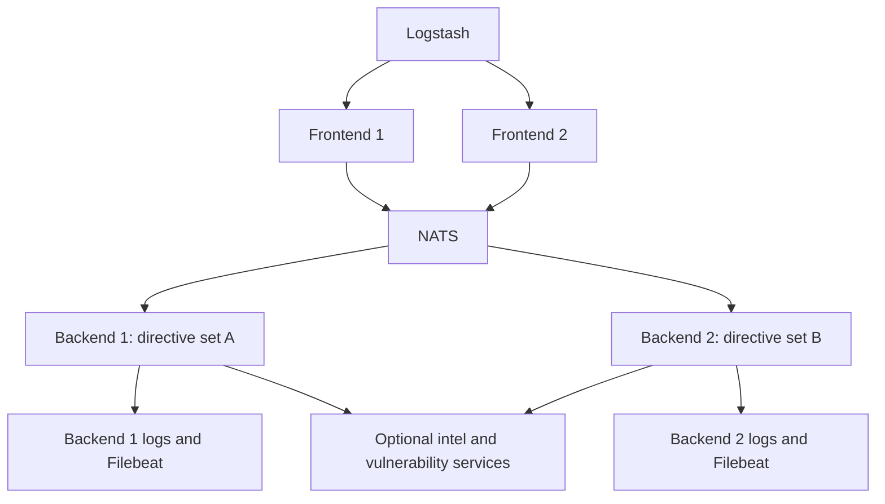

# Advanced Deployment

Dsiem consists of frontend and backend nodes that communicate through NATS messaging for horizontal scalability. The architecture is depicted in the following diagram.

## About the architecture

Frontends validate incoming normalized events and publish them through NATS. They keep no correlation state, so an ingestion service can distribute requests across frontend replicas. Each replica still has local queues and rate-limiter state.

Assign a different, exclusive set of directives to each backend. Every backend receives the event stream, but applies only its locally loaded directives. Backlogs stay in that backend's memory and are not synchronized with other nodes. This makes directive ownership part of deployment configuration: adding a replica does not move rules automatically, and a failed backend's rules are not picked up elsewhere.

Broadcasting the stream to every backend also increases NATS-to-backend traffic as nodes are added. Measure that traffic alongside CPU and queue usage.

### Distributing Work Between Backends

A Dsiem backend will pull files from frontend `configs` directory into its own, but will *only* fetch directives files whose name matches its `node` startup parameter.

For instance, in the example [`docker-compose.yml`](../deployments/docker/docker-compose.yml), backend container is started with `DSIEM_NODE` environment variable set to `dsiem-backend-0`. The download filter uses the filename prefix `directives_dsiem-backend-0`. Use names such as `directives_dsiem-backend-0_custom.json`, and avoid overlapping node-name prefixes: `dsiem-backend-1` also matches files starting with `directives_dsiem-backend-10`.

To distribute the work:

* Start each backend with a unique `node` parameter;
* Split your directives into separate files;
* Name those files with the assigned backend prefix; and
* Have those files available in all frontend nodes `configs` directory.

### Deployment on Kubernetes

For a Kubernetes deployment, use the following layout:

* For frontend nodes:
  - To centrally manage directive files, use a shared storage (e.g. NFS, CIFS) on frontend nodes to mount `configs` directory. The frontend serves these files to backends over HTTP. Backends download and load them at startup; replacing a file does not reload a running backend.
  - For high availability and load balancing, create a K8s service for frontends and have logstash instances send logs to that service.
  - Frontends can run as Deployments. They need writable `configs/` storage because startup writes `dsiem_config.json`, even when HTTP configuration writes are disabled. A read-only ConfigMap mounted over that directory is insufficient; copy configuration into a writable volume or mount files separately.

* For backend nodes:
  - Use [StatefulSets](https://kubernetes.io/docs/concepts/workloads/controllers/statefulset/) to have a stable/predictable pod names, and use the pod name to set `DSIEM_NODE` container environment variable. This allows you to distribute work among backends by naming the directive files (located in frontend nodes) based on the backend StatefulSet's pod name prefix and number of replicas.

  - Mount a persistent storage for backend `logs` directory, and have a filebeat container in the same pod to harvest those logs. Have a look at how this is done in the docker compose examples as a starting point.

## Configuration and recovery boundaries

The [download filter](../server/src/config.rs) also fetches `assets_`, `intel_`, and `vuln_` files. Downloads overwrite matching local files but do not remove old ones. The backend then loads every local `directives_*.json` file, so stale files or a directory shared with another backend can defeat the intended assignment. Give each backend its own writable configuration directory and remove obsolete files during a controlled restart.

Persist each backend's `logs/` separately and enable `DSIEM_RELOAD_BACKLOGS` if you need graceful-restart recovery. The sample Compose files disable it. Recovery uses saved in-memory backlogs; it does not replay events missed while the backend was stopped. There is no automatic reassignment of a failed backend's directives.

The NATS event and overload subjects are fixed in code. Deployments using the same NATS account/subject space share that traffic; node names alone do not isolate separate environments.

The repository provides Compose examples and Kubernetes deployment guidance, but no Kubernetes manifests. Configure storage, service access, and authentication for the target environment; see [security](security.md).
