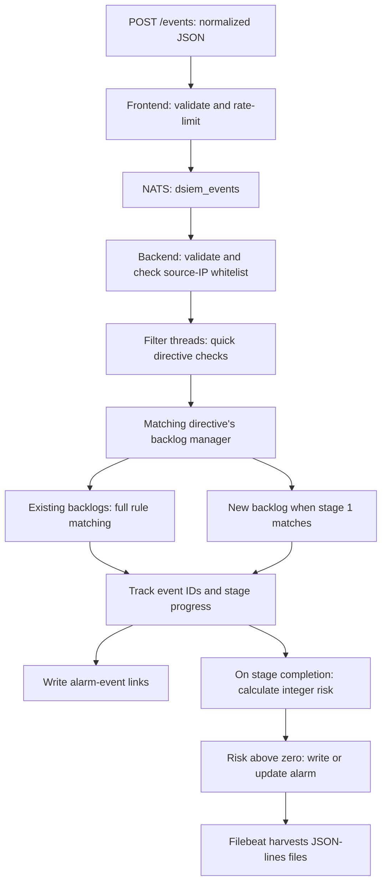

# Event flow inside the server

This page follows the Rust server implementation. For the surrounding Logstash, Filebeat, and Elasticsearch pipeline, see [Event processing](event_processing.md).

## Receive and distribute events

[`events_handler`](../server/src/server.rs) accepts one JSON object or an array at `/events` and `/events/`. The caller must already have converted its logs into the [normalized event format](dsiem_plugin.md#normalized-event). The frontend deserializes and validates that format; it does not parse arbitrary device logs.

The handler processes array entries in order, checks the rate limiter, adds the frontend receipt time and trace context, and sends each event to an in-memory channel. Event deserialization failures return HTTP 400, failed event validation returns 418, and rate limiting returns 429. The JSON extractor currently maps its own rejections through the generic HTTP 500 error conversion. An array is not atomic: earlier entries may already have been accepted when a later entry fails.

The [frontend messenger](../server/src/messenger.rs) publishes events to the NATS subject `dsiem_events`. Each backend subscribes independently, so every backend receives the stream and applies its own directives. This uses NATS publish/subscribe without JetStream persistence or processing acknowledgments. HTTP success confirms frontend acceptance, not completed correlation or durable storage.

The backend validates the event again and skips it if its source address matches a whitelisted asset. A whitelisted destination alone does not cause this skip.

## Filter and correlate

[`Filter`](../server/src/filter.rs) divides directives across dedicated threads. Quick checks use plugin ID/SID pairs or product/category pairs, with caches to avoid repeating checks. Full address, port, protocol, reference, and custom-data matching happens in the [rules](../server/src/rule.rs) used by backlogs and their managers.

A [backlog manager](../server/src/backlog/manager.rs) handles one directive. It gives existing backlogs a chance to consume an event before creating a new backlog from a stage-1 match. By default, managers start on demand and unload after they have no backlogs for the configured idle period. `--preload-all-directives` keeps all managers loaded. Directive definitions themselves are read at startup in both modes.

A [backlog](../server/src/backlog/mod.rs) tracks a detection's rule stages, event IDs, involved addresses, risk, and optional enrichment. A stage completes when its matching event-ID count reaches `occurrence`. Dsiem then calculates risk and advances to the next stage, or removes the completed backlog after its final alarm update. Expiration marks the current stage as timed out, writes an update if risk is nonzero, and removes the backlog from memory.

An alarm can appear before the last stage. See [Directive and alarm](directive_and_alarm.md) for timing, risk calculation, and an example.

## Output and restart behavior

The [log writer](../server/src/log_writer.rs) appends JSON lines to two files under `logs/` beside the backend executable:

- `siem_alarm_events.json`: alarm ID, event ID, and stage for matched events. These links can be written before the backlog has enough risk to produce an alarm.
- `siem_alarms.json`: alarm snapshots and updates, written only when risk is nonzero.

Live backlogs remain in memory. With `DSIEM_RELOAD_BACKLOGS=true`, graceful shutdown saves active backlogs to `logs/backlogs/<directive_id>.json`. Startup attempts to restore them for loaded directives. This is restart recovery, not continuous checkpointing; a forced kill does not save current state. See the [restart notes](../README.md#saving-and-reloading-backlogs-on-restart).

## Overload behavior

The processing channels have finite capacity. Slow consumers can lag and skip events, and NATS can report slow-consumer losses. Backlogs can send overload signals through `dsiem_overload_signals` when processing delay exceeds `max_delay`; frontends then reduce their acceptance rate. This does not guarantee lossless or ordered end-to-end delivery. See [Managing performance](managing_performance.md).
