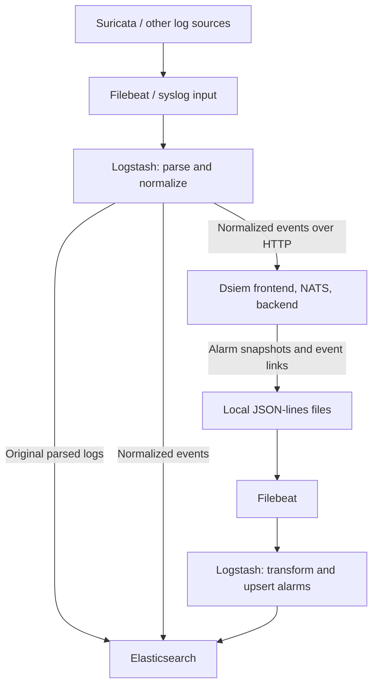

# Event processing through the logging stack

This page describes the [supplied Logstash and Filebeat configuration](../deployments/docker/conf). For processing inside the Rust binaries, see [Event flow inside the server](event_flow.md).

## Original and normalized events

The sample Filebeat configuration labels Suricata records with `application: suricata`. Logstash's [input](../deployments/docker/conf/logstash/conf.d/00_input.conf) receives them, and [50_suricata.conf](../deployments/docker/conf/logstash/conf.d/50_suricata.conf) prepares their fields.

[70_siem-plugin-suricata.conf](../deployments/docker/conf/logstash/conf.d/70_siem-plugin-suricata.conf) clones matching alert records and converts the copies into [normalized events](dsiem_plugin.md#normalized-event). It labels the copies with `[@metadata][siem_data_type] = normalizedEvent`. Original records go through [99_output.conf](../deployments/docker/conf/logstash/conf.d/99_output.conf) into `suricata-*`.

[80_siem.conf](../deployments/docker/conf/logstash/conf.d/80_siem.conf) assigns each normalized event a UUID in `event_id`, overwriting any existing value. It sends that event both to Dsiem's `/events` endpoint and to `siem_events-YYYY.MM.dd`, using the same event ID. The stored normalized event is the evidence later retrieved by the UI.

The sample uses one Logstash pipeline for these outputs. A separate output destination does not by itself isolate the main ingestion path from a blocked Dsiem output. Separate the delivery paths if that isolation is required.

## Correlation output

Dsiem correlates normalized events against configured directives. When a stage completes and integer risk becomes nonzero, it writes an alarm snapshot to `logs/siem_alarms.json`. Later stage completions and expiration can write updates. Matched event links are written separately to `logs/siem_alarm_events.json`, including before an alarm reaches nonzero risk. See [Directive and alarm](directive_and_alarm.md).

Filebeat reads both files from the backend's logs volume, attaching `application: siem` and `siem_data_type: alarms` or `alarm_events`. Its [sample configuration](../deployments/docker/conf/filebeat/filebeat.yml) uses `tail_files: true` for these inputs. With no existing registry position, that starts reading at the end of a discovered file, so older output may not be imported.

## Storing and updating alarms

Logstash converts `created_time` and `update_time` into `timestamp` and `updated_time`, stores event links in `siem_alarm_events-*`, and upserts alarms into daily `siem_alarms-*` indices. The `siem_alarms` alias lets the UI search across those indices.

The alarm lookup uses `siem_alarms_id_lookup` and `perm_index` to direct later updates back to the original index. The update script preserves analyst status and tag, rejects lower-risk updates, and rejects older updates at equal risk. See [Elasticsearch indices](es_indices.md) for the lookup boundaries.

## Adding sources

Keep source parsing before normalization in the file ordering, and normalization before the shared SIEM processing. The sample uses `50_*` for source parsing, `70_*` for normalization plugins, and `80_siem.conf` for shared delivery and alarm handling. Adapt these filters together when adding a source; a parsed log that never becomes a valid normalized event will not reach correlation through this pipeline.
