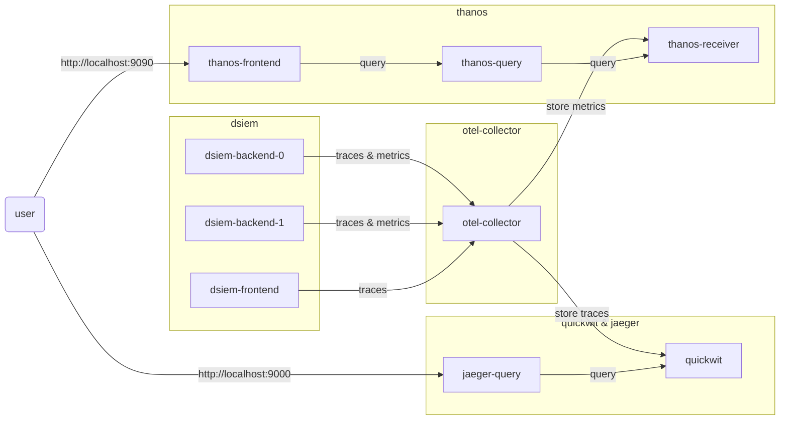
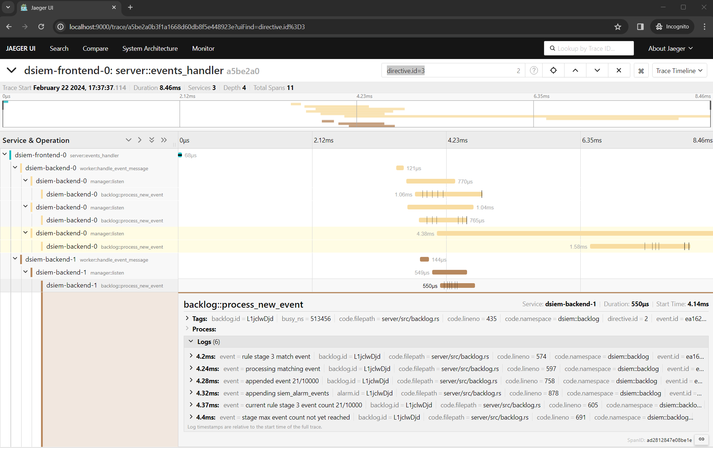
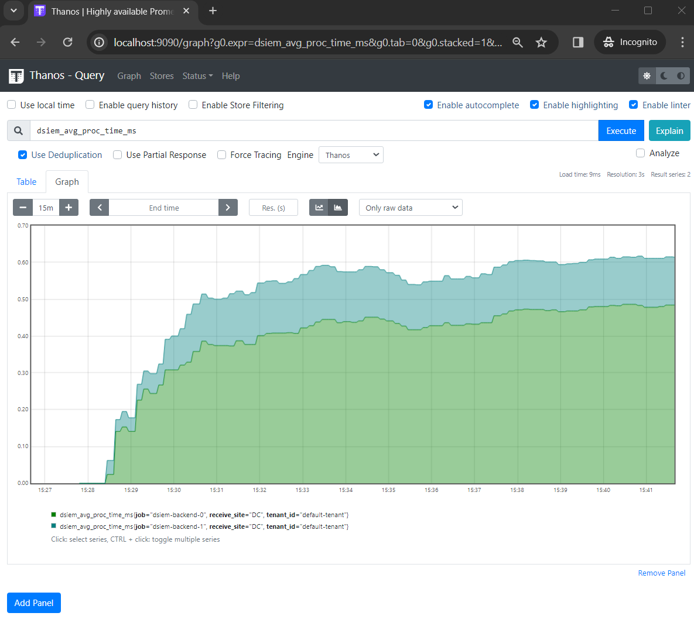

# Telemetry

Dsiem-rs exports traces and metrics to an OpenTelemetry collector. The example collector sends traces to Quickwit for Jaeger queries and metrics to Thanos.

Set `DSIEM_OTEL_TRACING_ENABLED=true` on the frontend and backends to export traces. Set `DSIEM_OTEL_METRICS_ENABLED=true` on backends to export metrics. Both use the OTLP gRPC endpoint in `DSIEM_OTEL_ENDPOINT` (default `http://localhost:4317`). Export is disabled by default.

Example configuration is available from this [docker-compose](../deployments/docker/docker-compose-telemetry.yml) file. That setup produces this architecture:



>[!NOTE]
>The example Docker compose environment doesn't store quickwit and thanos data to a volume, so their data can be lost when containers are removed or recreated. Restarting the same container does not by itself clear its writable layer. Consult each project's documentation on how to setup permanent storage if needed.

## Traces

Traces follow events as they travel from frontend to backends and reach matching directives and backlogs. Below is a view of Jaeger UI showing an event being processed by 2 backends each having 1 and 3 directives. The UI makes it easy to locate specific item of interest, which in this case is `directive.id=3` (result is highlighted in yellow).



>[!NOTE]
>To see log events in traces as shown above, make sure to set `DSIEM_DEBUG` or `DSIEM_TRACE` to `true`. There's no difference between logs in traces and terminal console (stdout), both are controlled by the same environment variables or startup flags.

## Metrics

The [watchdog](../server/src/watchdog.rs) logs a report every 10 seconds. With metric export enabled, the [meter](../server/src/meter.rs) exports these values as observable gauges with the `dsiem_` prefix.

| Log field | Meaning |
| --- | --- |
| `eps` | Mean throughput reported by the backend receive counter, before source-IP whitelist filtering; not a completed-correlation rate |
| `queue_length` | Events retained in the backend's broadcast receive queue |
| `directives_ttl` | Enabled directives loaded at startup |
| `directives_active` | Managers whose latest report contains at least one active backlog |
| `events_rcvd` | Backend receive count since the last watchdog report; resets after reporting |
| `events_matched` | Sum of the latest per-manager counts of events received after quick filtering; not unique events or confirmed full-rule matches |
| `backlogs` | Sum of active backlogs in the latest manager reports |
| `backlogs_timedout` | Sum of manager-reported backlog response timeouts; not expired detection rules |
| `avg_proc_time_ms` | Mean of recorded backlog response durations in milliseconds |

Managers reset their event counts on their own 10-second reporting timers, which are not synchronized with the watchdog. One event sent to several directives can contribute several times to `events_matched`.

The processing-time histogram is retained between reports. It is cleared when the reported matched count is zero, or when the watchdog warns about excessive processing time while the receive queue is nonempty. It is not a fresh average of each 10-second interval. The receive-rate helper also injects a count after a prolonged idle period to wind down its histogram, so these measurements should not be used as exact ingestion accounting.

Here's an example of Thanos frontend displaying the graph of `avg_proc_time_ms`. Prefix `dsiem_` is added to all metrics for easier search experience.  Prometheus supports advanced queries and can be set to send alerts when a certain baseline/threshold is breached.



Dsiem also prints those measurements regularly to console (stdout). You can use `grep` to filter for `dsiem::watchdog`, or as shown below with `jq` if Json log format is enabled:

```shell
docker logs -f dsiem-backend-0 --since=10s | jq -c --unbuffered '. | select(.target=="dsiem::watchdog")'
```

Example output:

```jsonl
{"timestamp":"2024-03-26T04:44:50.978559Z","level":"INFO","fields":{"message":"watchdog report","eps":7530.67,"queue_length":0,"avg_proc_time_ms":0.006,"directives_ttl":23691,"directives_active":42,"events_rcvd":45495,"events_matched":755,"backlogs":42,"backlogs_timedout":0},"target":"dsiem::watchdog"}
{"timestamp":"2024-03-26T04:45:00.983794Z","level":"INFO","fields":{"message":"watchdog report","eps":8162,"queue_length":3756,"avg_proc_time_ms":0.006,"directives_ttl":23691,"directives_active":92,"events_rcvd":77216,"events_matched":46236,"backlogs":92,"backlogs_timedout":0},"target":"dsiem::watchdog"}
{"timestamp":"2024-03-26T04:45:10.978341Z","level":"INFO","fields":{"message":"watchdog report","eps":8715.45,"queue_length":0,"avg_proc_time_ms":0.006,"directives_ttl":23691,"directives_active":179,"events_rcvd":93054,"events_matched":73007,"backlogs":179,"backlogs_timedout":0},"target":"dsiem::watchdog"}
{"timestamp":"2024-03-26T04:45:20.977917Z","level":"INFO","fields":{"message":"watchdog report","eps":8317.48,"queue_length":0,"avg_proc_time_ms":0.006,"directives_ttl":23691,"directives_active":282,"events_rcvd":84219,"events_matched":97003,"backlogs":282,"backlogs_timedout":1},"target":"dsiem::watchdog"}
```
