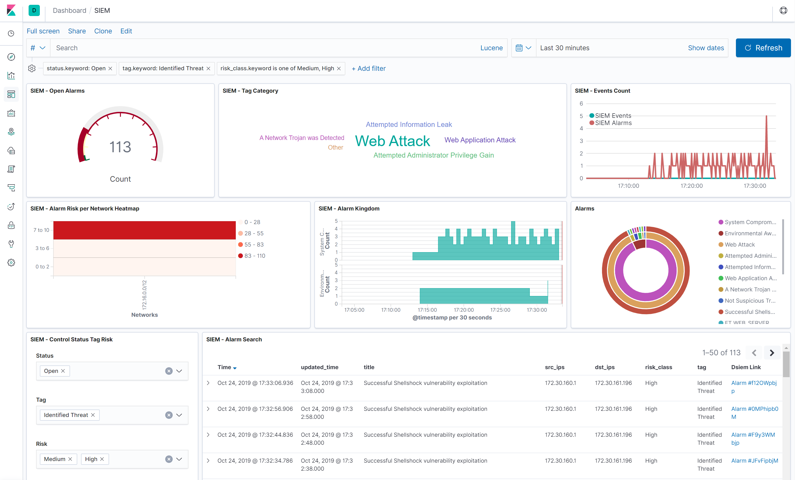
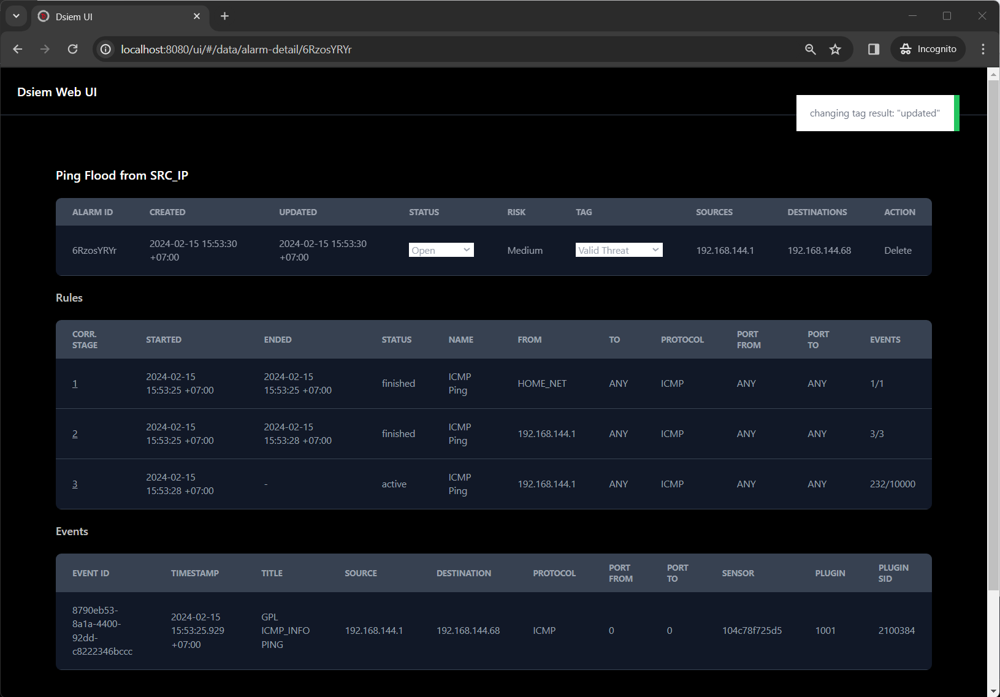

# Web Interfaces

Dsiem comes with an example Kibana dashboard ready for import, and a web UI for deleting and managing alarms status and tag.

## Kibana Dashboard

Dsiem's example Kibana dashboard can be imported using the step provided [here](./installation.md#importing-the-kibana-dashboard). The result should be similar to this:

The dashboard also provide a URL link (through Kibana scripted field) called `Dsiem Link` that will open each alarm on Dsiem web UI.

## Dsiem Web UI

The web UI home page is accessible from http://dsiem-address:8080/ui/. Normally you will access this app by clicking on specific alarm `Dsiem Link` from Kibana dashboard.

From the alarm page above, you can interact with the following cell:
* **Status**: to change the alarm Status from `Open` to `In-Progress` or `Closed`.
* **Tag**: to change the alarm's tag from `Identified Threat` to `False Positive`, `Valid Threat`, or `Security Incident`.
* **Delete**: to delete the alarm and its associated links from Elasticsearch.

>[!TIP]
>The above statuses and tags can be customized by supplying the appropriate dsiem [startup parameter](./commands.md).

## Data access and limits

The UI fetches status/tag choices from `/config/dsiem_config.json` and Elasticsearch/Kibana URLs from `/ui/assets/config/esconfig.json`. It then reads and updates Elasticsearch directly. A separately hosted UI must provide both configuration routes. See [security and access control](security.md).

The [alarm service](../web/src/services/alarm.rs) searches up to 10,000 alarm-event links and loads at most 500 event documents for an alarm. Missing event documents are skipped. Use Kibana to investigate beyond those display limits; a short event list does not prove that the alarm had no other supporting events.

Deleting an alarm removes its alarm document and the event links retrieved by the UI. It does not remove the normalized events from `siem_events-*`, and the link-search limit means very large alarms may retain links. Deleting or closing an alarm in Elasticsearch does not stop an active backend backlog.

The frontend supplies UI status/tag choices, while each backend supplies defaults for new alarms. Configure both consistently. Engine updates in the supplied Logstash pipeline preserve an existing document's analyst-managed status and tag.
